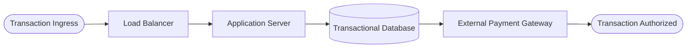
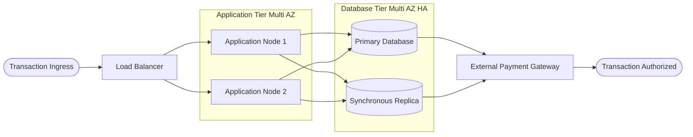

# Problem Statement and System Architecture Context

## Context and Problem Formulation

Modern digital payment platforms require continuous and uninterrupted execution because temporary outages generate immediate financial losses, contractual penalties, and reputational damage. Within cloud environments, processing an electronic transaction depends on the sequential coordination of distinct functional modules, namely incoming traffic distribution, transactional business logic execution, data persistence, and external settlement network communication. 

In an unredundant distributed deployment, these components operate in a logical series configuration. As established by classical reliability theory, the overall operational availability of a series network is strictly constrained by its least reliable component. The failure of any individual tier halts the processing pipeline, causing transaction drops and system level unresponsiveness. Because cloud vendors do not release proprietary hardware failure telemetry, system engineers must quantify operational limits conservatively through published Service Level Agreements.

## Architectural Topologies and Structural Diagrams

The target platform consists of four functional subsystems, comprising a load balancer, an application compute engine, a transactional relational database, and an external payment gateway. Two structural configurations are investigated to analyze the benefits of fault tolerance mechanisms.

### Baseline Topology

The baseline design represents a non-redundant series configuration where each layer presents a single point of failure.

In this baseline setup, any interruption on the compute instance or database engine renders the entire payment flow unavailable.

### Improved Redundant Topology

The enhanced architecture incorporates active multi availability zone redundancy into the critical compute and database layers, reorganizing the system into a series parallel reliability block diagram.

In this redundant model, the application tier functions under active parallel redundancy where at least one compute node must remain operational, while the database leverages automatic failover with continuous state synchronization.

## Methodological Modeling Framework

The modeling strategy assumes that every subsystem operates within its standard operational lifespan, exhibiting constant failure rates $\lambda$ and constant repair rates $\mu$. The contractual availability $A_i$ stated in vendor documentation relates to the mean time between failures and the mean time to repair through the formulation

$$A_i = \frac{\text{MTBF}_i}{\text{MTBF}_i + \text{MTTR}_i} = \frac{\mu_i}{\lambda_i + \mu_i}$$

For the baseline series structure, overall system availability corresponds to the product of individual component availabilities

$$A_{\text{base}} = \prod_{i=1}^{4} A_i$$

Preliminary evaluations parameterized with standard commercial cloud contracts show that the baseline availability reaches approximately $98.943\%$, which corresponds to more than $92$ hours of accumulated downtime every year. The single instance application and database servers account for more than $94\%$ of all outages. 

Implementing multi zone parallel redundancy elevates the steady state availability to $99.880\%$, diminishing annual downtime to around $10.51$ hours. This represents an $88.6\%$ reduction in operational disruption, subsequently shifting the primary availability bottleneck toward the external third party payment gateway.

## Scope of the Repository

This repository hosts the computational implementation of the analytical equations alongside discrete event numerical simulations based on the Monte Carlo method. Repository assets are organized to enable reproducible execution of availability derivations, statistical convergence validation across $10^4$ simulated annual cycles, and visual generation of reliability curves and Pareto charts. Developers working on the codebase can trace mathematical principles directly to modular Python implementations and interactive Jupyter notebooks.

## References

[1] P. D. T. O'Connor and A. Kleyner, *Practical Reliability Engineering*, 5th edition, Chichester, United Kingdom, John Wiley and Sons, 2012, DOI 10.1002/9781119961260.

[2] D. W. Benbow and H. W. Broome, *The Certified Reliability Engineer Handbook*, 1st edition, Milwaukee, Wisconsin, ASQ Quality Press, 2009.

[3] E. Zio, *The Monte Carlo Simulation Method for System Reliability and Risk Analysis*, London, United Kingdom, Springer, 2013, DOI 10.1007/978-1-4471-4588-2.

[4] K. S. Trivedi and A. Bobbio, *Reliability and Availability Engineering. Modeling, Analysis, and Applications*, Cambridge, United Kingdom, Cambridge University Press, 2017, DOI 10.1017/9781316163047.

[5] M. Rausand and A. Høyland, *System Reliability Theory. Models, Statistical Methods, and Applications*, 2nd edition, Hoboken, New Jersey, John Wiley and Sons, 2004, DOI 10.1002/9780470316900.

[6] A. Birolini, *Reliability Engineering. Theory and Practice*, 8th edition, Berlin, Germany, Springer-Verlag, 2017, DOI 10.1007/978-3-662-54209-5.

[7] J. Araujo, D. Oliveira, R. Matos, G. Alves, and P. Maciel, "Availability and reliability modeling of mobile cloud architectures," *IEEE Transactions on Industrial Informatics*, volume 22, issue 3, pages 1622 to 1634, March 2026, DOI 10.1109/TII.2023.3254547.

[8] R. Ghosh, F. Longo, R. Xia, V. K. Naik, and K. S. Trivedi, "Stochastic model driven capacity planning for an infrastructure-as-a-service cloud," *IEEE Transactions on Services Computing*, volume 7, issue 4, pages 667 to 680, October 2014, DOI 10.1109/TSC.2013.44.

[9] M. Oszczypała, J. Konwerski, J. Ziółkowski, and J. Małachowski, "Reliability analysis and redundancy optimization of $k$-out-of-$n$ systems with random variable $k$ using Continuous Time Markov Chain and Monte Carlo simulation," *Reliability Engineering and System Safety*, volume 242, article 109780, February 2024, DOI 10.1016/j.ress.2023.109780.

[10] A. Singjai and U. Zdun, "Conformance assessment of architectural design decisions on API endpoint designs derived from domain models," *Journal of Systems and Software*, volume 193, article 111433, November 2022, DOI 10.1016/j.jss.2022.111433.

[11] Amazon Web Services, "Amazon Compute Service Level Agreement," AWS, 2023, available online at https://aws.amazon.com/compute/sla/, accessed November 2026.

[12] Amazon Web Services, "Amazon RDS Service Level Agreement," AWS, 2023, available online at https://aws.amazon.com/rds/sla/, accessed November 2026.

[13] Amazon Web Services, "Amazon Elastic Load Balancing Service Level Agreement," AWS, 2023, available online at https://aws.amazon.com/elasticloadbalancing/sla/, accessed November 2026.

[14] Microsoft Corporation, "Service Level Agreements (SLA) for Online Services," Microsoft Licensing Agreements, 2023, available online at https://www.microsoft.com/licensing/docs/view/Service-Level-Agreements-SLA-for-Online-Services, accessed November 2026.

[15] Google Cloud, "Google Cloud Platform Service Level Agreements," Google Cloud Documentation, 2023, available online at https://cloud.google.com/terms/sla, accessed November 2026.